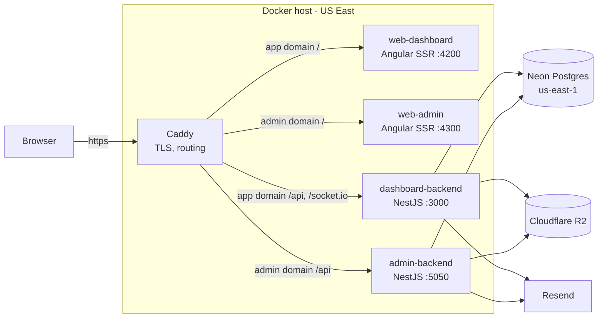

# Deployment

Skooltrak runs as one Docker Compose stack on a single server, with Caddy in front, a managed
Postgres (Neon) next to it, Cloudflare R2 for files and Resend for email. GitHub Actions builds
the images, migrates the database and rolls the server forward on every push to `main`.



## Why this shape

- **Same-origin API is required, not optional.** The frontends call `/api` and `/socket.io` on
  their own origin (the auth client uses `window.location.origin`, the chat sockets use
  `location.host`), and there is no setting to point them at another host. Caddy routes those
  paths to the right backend per domain, and handles TLS and WebSocket upgrades on its own.
- **Region: US East.** Users are in Panama (the default school timezone), which is closer to
  Virginia than to São Paulo. The server and Neon sit in the same metro (Ashburn / AWS
  `us-east-1`), so each database query stays around a millisecond.
- **One server** is the simplest thing that fits today's load: five small containers, about
  2–3 GB of RAM in total. Postgres is managed, so the server holds no data and can be rebuilt
  from this repo and its `.env` at any time.

## Layout

| Path | What it is |
| --- | --- |
| `apps/*/Dockerfile` | One image per app. Backends run on Bun, frontends on Node 24 (Angular 22 needs `^22.22.3 \|\| ^24.15.0`). |
| `deploy/compose.yml` | The production stack. Images are `ghcr.io/joelnieto/skooltrak-<app>:<git sha>`. |
| `deploy/Caddyfile` | Domains, TLS, routing. |
| `deploy/.env.example` | Every variable the server needs. The real `.env` lives only on the server. |
| `.github/workflows/ci.yml` | Lint and build on pull requests (tests run but don't block yet). |
| `.github/workflows/deploy.yml` | CI → build and push images → migrate → roll out. |

## One-time setup

### 1. Neon (database)

1. Create a project in **AWS `us-east-1`**, Postgres 17, database `skooltrak`.
2. Turn on point-in-time restore (history retention) for the production branch.
3. Copy two connection strings:
   - **Pooled** (host contains `-pooler`): the apps use this one → `DATABASE_URL` in the server `.env`.
   - **Direct**: migrations use this one → GitHub secret `MIGRATION_DATABASE_URL`.

### 2. Cloudflare R2 (files)

Create a bucket and an API token scoped to that bucket (Object Read & Write). Note the account
endpoint, key ID and secret.

### 3. Resend (email)

Add and verify your sending domain (it gives SPF/DKIM records to add in DNS) and create an API key.
Sign-up requires email verification, so this must work before the first user signs up.

### 4. Server

Any x86 Ubuntu 24.04 VM in US East with **2 vCPU / 4 GB RAM**. AWS Lightsail in `us-east-1`
shares a region with Neon (about 1 ms per query); DigitalOcean NYC also works (about 5–7 ms).

```bash
# as root
curl -fsSL https://get.docker.com | sh
adduser --disabled-password --gecos '' deploy
usermod -aG docker deploy
ufw allow OpenSSH && ufw allow 80/tcp && ufw allow 443/tcp && ufw allow 443/udp && ufw --force enable

# as deploy
mkdir -p ~/skooltrak && cd ~/skooltrak
# create .env from deploy/.env.example, fill it in, then:
chmod 600 .env
```

Create an SSH key pair for GitHub Actions (on your machine, not the server), add the public key
to `/home/deploy/.ssh/authorized_keys`, and keep the private key for the next step.

### 5. DNS

Point both domains at the server's IP (A, plus AAAA if it has IPv6). If they are on Cloudflare,
set the records to **DNS only** (grey cloud) so Caddy can get its certificates; you can turn the
proxy on later with SSL mode "Full (strict)".

### 6. GitHub

Create the environment **`production`** (Settings → Environments) with:

| Kind | Name | Value |
| --- | --- | --- |
| Secret | `MIGRATION_DATABASE_URL` | Neon **direct** connection string |
| Secret | `DEPLOY_HOST` | Server IP or hostname |
| Secret | `DEPLOY_USER` | `deploy` |
| Secret | `DEPLOY_SSH_KEY` | The private key from step 4 |
| Secret | `DEPLOY_KNOWN_HOSTS` | Output of `ssh-keyscan <server>` (pins the server's key) |
| Variable | `APP_DOMAIN` | e.g. `app.skooltrak.com` (shown as the deployment URL) |

Optionally add yourself as a **required reviewer** so each deploy waits for a click.

### 7. First deploy

Run **Actions → Deploy → Run workflow**. It applies every migration to the empty database and
seeds roles and permissions. Then create the first admin from your machine (once):

```bash
DATABASE_URL='<direct url>' ADMIN_EMAIL=... ADMIN_PASSWORD=... ADMIN_FIRST_NAME=... ADMIN_LAST_NAME=... \
  bun run prisma/scripts/seed-admin.ts
```

## Every deploy

Merging to `main` runs `deploy.yml`:

1. **CI**: lint and build the affected projects.
2. **Images**: build the four images and push them tagged with the commit SHA (and `latest`).
3. **Migrate**: `prisma migrate deploy` against Neon, then the idempotent roles/permissions seed.
4. **Roll out**: copy `compose.yml` and `Caddyfile` to the server, pull the new images and restart;
   `--wait` fails the job if a container doesn't become healthy within 3 minutes.

Deploys never overlap. A newer push waits for the running one to finish.

## Rollback

- **Code**: every image is kept by SHA. On the server:
  `cd ~/skooltrak && IMAGE_TAG=<previous sha> docker compose up -d --wait`.
- **Database**: migrations only go forward. Restore the Neon branch to a point before the deploy
  (or branch from it), and roll the code back with it. Don't run old code against a schema that a
  newer migration changed.

## Operating it

| Task | Command (in `~/skooltrak` on the server) |
| --- | --- |
| Status / health | `docker compose ps` |
| Logs | `docker compose logs -f --tail=200 dashboard-backend` |
| Restart one service | `docker compose restart web-dashboard` |
| Change a secret | edit `.env`, then `docker compose up -d` |
| Reload routing | `docker compose exec caddy caddy reload --config /etc/caddy/Caddyfile` |

## Check before a launch

- [ ] Sign up → verification email arrives → log in → log out.
- [ ] Password reset email and link.
- [ ] Students and messages page through correctly.
- [ ] File upload and download (R2).
- [ ] Chat updates live (Socket.IO through Caddy).
- [ ] Public store at `/store/<slug>`.
- [ ] Admin: log in, page users / permissions / schools, open the roles form.
- [ ] View source on a dashboard page shows rendered HTML (SSR), not an empty shell.

## Rough monthly cost

| Item | Cost |
| --- | --- |
| Server (2 vCPU / 4 GB) | ~$20–25 |
| Neon (Launch plan) | ~$19 |
| Cloudflare R2 | ~$0–5 |
| Resend | free tier to start |
| GitHub Actions + GHCR | free for this usage on a public repo; minutes count on a private one |

## Troubleshooting

- **`PrismaConfigEnvError: DATABASE_URL`** in a build: `prisma.config.ts` needs the variable even
  for `generate`. The Dockerfiles and CI set a placeholder; keep it if you add new ones.
- **SSR returns 4xx / falls back to client rendering**: the request host isn't in
  `NG_ALLOWED_HOSTS` (set from `APP_DOMAIN` / `ADMIN_DOMAIN` in `compose.yml`).
- **Login works but API calls 401 / CORS errors**: `APP_DOMAIN` / `ADMIN_DOMAIN` in `.env` must match
  the browser's host exactly (they feed `CORS_ORIGINS`, `TRUSTED_ORIGINS` and `BETTER_AUTH_URL`).
- **Caddy can't get a certificate**: DNS doesn't point at the server yet, port 80 is blocked, or
  Cloudflare's proxy is on (grey-cloud the records first).
